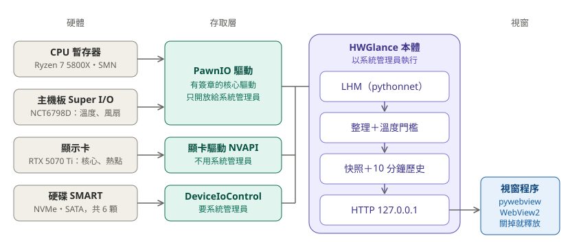

# HWGlance 規格與進度

## 需求（使用者 2026-10-29）

新的硬體監控軟體：UI/UX 與功能參考 NZXT CAM、輕量、簡潔，**一眼看出目前所有硬體的溫度**，並說明技術怎麼實現。
這台電腦裝了 HWMonitor 1.68。

## 架構

CPU 與主機板的溫度要靠核心驅動才讀得到（Windows 不讓一般程式碰 I/O 埠與 CPU 暫存器），所以本體要以系統管理員執行；
顯示卡溫度由顯卡驅動提供，不需要。視窗只透過本機 HTTP 拿快照，關掉視窗時 WebView2 整個釋放。

## 決策

| # | 決策 | 原因 |
|---|---|---|
| D1 | 資料來源用 LibreHardwareMonitorLib 0.9.6（net472），從官方 release 取、SHA-256 釘在 `scripts/fetch_lhm.py` | 開源（MPL-2.0）、支援這台所有硬體；HWMonitor 免費版沒有 API／共享記憶體 |
| D2 | 驅動用 PawnIO（官方簽章版，使用者自己安裝），不用 WinRing0 | WinRing0 有漏洞、2025 起被 Defender 標記；LHM 0.9.5 起改用 PawnIO |
| D3 | Python＋pywebview＋React／TS／Vite／Tailwind（版本同 MusicHub、ProjectHub） | 使用者的主力組合；不用 Electron（不另外打包瀏覽器）。備案：C# WPF 原生 |
| D4 | 本體（感測＋API）與視窗分成兩個程序 | 關掉視窗時 WebView2 整個釋放；第 3 段加系統匣後，背景只剩本體 |
| D5 | 每秒更新；硬碟 SMART 每 10 秒 | 溫度一秒夠即時；SMART 讀得慢、硬碟溫度變得慢 |
| D6 | API 只綁 127.0.0.1、Host 檢查、改東西要 token；API 只讀 | 本體以系統管理員執行，攻擊面要小 |
| D7 | 固定埠 8796（被占用就換空的）；單一執行個體靠 `data/instance.json`＋`--activate` | localStorage 才記得住設定；再開一次不跳第二次 UAC |
| D8 | 溫度門檻依硬體種類（下表），到達就算 | 各種硬體能承受的溫度差很多 |
| D9 | 總覽放：CPU 主溫度、GPU 核心與熱點（顯卡有的話；RTX 50 沒有）、主機板與晶片組、每顆硬碟、DIMM、水溫；其他硬體放最熱的一個 | 「一眼看出所有硬體的溫度」；細項在各自的卡片 |
| D10 | 從沒轉過的風扇不列、只計數；Super I/O 超出 -40～125°C 的通道視為沒接；硬碟的警告／臨界溫度是門檻不是讀數 | 避免一堆 0 RPM 與垃圾數字 |
| D11 | 第一版不做：燈效、風扇曲線、遊戲內 FPS、帳號 | 輕量；風扇曲線要寫入主機板晶片、有風險；FPS 已有 RivaTuner |
| D12 | 深色為主、跟著系統深淺色；前端不寫 px；不用 NZXT 的名稱與商標 | 參考 CAM 的版面，不仿冒品牌 |
| D13 | 關掉視窗預設留在系統匣（設定可改成整個結束）；第一次關掉時跳通知說明一次 | 監控要一直在；背景只剩本體，比開著視窗省很多 |
| D14 | 系統匣圖示直接畫 CPU 溫度數字（沒有 CPU 溫度就畫 GPU），底色跟著等級；左鍵開主畫面、右鍵選單 | 工作列上一眼就看得到，不用開視窗 |
| D15 | 迷你視窗：無邊框、置頂、340×112，CPU／GPU 溫度與負載＋其他硬體最需要注意的一個；位置記下來，預設右下角 | CAM 的 mini mode；小到可以一直放著 |
| D16 | 主畫面與迷你在同一個視窗程序裡切換；系統匣、`--activate` 要切換時，本體排指令、視窗程序長輪詢 `GET /api/ui/commands` 拿 | 不重開程序，切換是瞬間的；視窗程序連不到本體就自己結束 |
| D17 | 設定（單位 °C／°F、更新頻率 1／2／5 秒、關視窗的行為、14 種門檻）存在 `data/settings.json`，經快照的 `prefs` 一秒內同步到所有視窗 | 門檻一律以 °C 存，換單位不影響判斷 |
| D18 | 晶片組門檻 80／90、NVMe 60／70（原本 70／80、55／70），SATA SSD 不變 | 真機閒置晶片組 78°C、KIOXIA 57°C 就亮黃燈；X570 晶片組平常 70～80°C，這兩顆 NVMe 自己回報的警告溫度是 71、74°C。使用者 2026-10-31 同意 |
| D19 | CPU 卡片不列 AMD 的 CCD 溫度（CPU 有 Tctl/Tdie 時） | CCD 是瞬間值，真機每秒在 48～78°C 之間跳，看起來像壞掉；Tctl/Tdie 是 AMD 平滑過的正式溫度。使用者 2026-10-31 同意 |
| D20 | 點總覽磚塊、卡片或硬碟那一列 → 跳出那個硬體的詳細資訊視窗（取代捲過去閃一下）：規格＋所有讀數分段，中文名稱、單位、專有名詞附一句說明，數字每秒更新；資料走唯讀的 `GET /api/device?id=`；規格開啟後讀一次（SMBIOS、WMI、Windows API），不顯示序號 | 使用者 2026-10-31：「按了一下只會閃一下很怪」，要點硬碟、CPU 看詳細資訊與規格 |
| D22 | 每種硬體一個顏色（CPU 藍、GPU 紫、主機板／晶片組青綠、記憶體粉、硬碟天藍，`tokens.css` 的 `--kind-*`），只用在外框（磚塊、卡片、詳細視窗、迷你格子，`.kind-frame`）；溫度的綠、黃、紅照舊不變。種類色避開黃、紅 | 使用者 2026-10-31：「太多綠色了，應該用不同的顏色區分不同種類的硬體」；先做成正常溫度也用種類色，使用者改口「警示顏色不變才對，改整體外框顏色就好」 |
| D21 | 總覽的小字寫看得懂的：CPU 寫型號（Ryzen 7 5800X）、主機板寫主機板型號、晶片組寫晶片組（X570）；不再寫 Tctl/Tdie、NCT6798D 這類代號（代號放在詳細資訊） | 同上，「盡量把資訊寫清楚」 |

### 溫度門檻（°C，`src/hwglance/sensors/thresholds.py`）

| 種類 | 偏高 | 過熱 | | 種類 | 偏高 | 過熱 |
|---|---|---|---|---|---|---|
| CPU | 80 | 90 | | NVMe SSD | 60 | 70 |
| GPU 核心 | 80 | 88 | | SATA SSD | 55 | 70 |
| GPU 熱點、顯存 | 95 | 105 | | 機械硬碟 | 45 | 55 |
| 主機板 | 50 | 65 | | DIMM | 60 | 75 |
| 晶片組 | 80 | 90 | | 水溫 | 40 | 45 |
| 供電（VRM） | 85 | 100 | | 電源 | 60 | 75 |
| 其他 | 70 | 85 | | | | |

晶片組與 NVMe 是 2026-10-31 依真機調高的（D18）。

## 進度

| 段 | 內容 | 狀態 |
|---|---|---|
| 1 | 感測核心（LHM 介面卡、示範資料、整理、背景服務）、探測工具 `probe.bat`、測試 | 2026-10-30 完成；2026-10-31 真機 probe 通過（見下） |
| 2 | API、單一執行個體、視窗子程序、`run.bat`／`setup.bat`、主畫面（總覽、CPU／GPU 大卡、主機板、記憶體、硬碟） | 2026-10-30 完成，用示範資料驗證（見下） |
| 3 | 迷你模式（置頂小視窗）、系統匣（關視窗留在背景、圖示畫 CPU 溫度）、設定（門檻、更新頻率、°C／°F） | 2026-10-30 完成，用示範資料驗證（見下） |
| 4 | 工具列圖示 `assets/app.ico`、桌面捷徑、登錄到 ProjectHub | 2026-10-30 完成（見下） |
| 5 | 詳細資訊視窗（D20、D21）：① 後端（讀規格、`details.py`、`GET /api/device`、總覽小字）② 前端視窗 | 2026-10-31 完成，用示範資料驗證（見下）；真機待使用者重開 HWGlance |

### 第 2 段的驗證（2026-10-30，示範資料）

- pytest 37 項、`npm run build` 通過。
- 內建瀏覽器：1200／760 寬、深色／淺色、沒有水平捲動；點總覽磚塊會捲到那張卡並閃一下；溫度到門檻會變色（CPU 81° 變黃）。
- 真的桌面視窗：1.9 秒出現；`--activate` 把原視窗叫到前面、不開第二個；關掉視窗後本體結束、`instance.json` 清掉。
- 開著視窗的私有記憶體：本體 41 MB、視窗程序 61 MB、WebView2 111 MB（共約 212 MB）；CPU 約整顆的 0.2%。
  本體是示範資料，接上 LHM 後會再多一些，要在真機重量。

### 第 3 段的驗證（2026-10-30，示範資料）

- pytest 56 項、`npm run build` 通過。
- 內建瀏覽器：設定面板改成 °F、CPU 偏高改 160°F 存檔 → 後端存成 71.1°C、所有溫度改顯示 °F、CPU 依新門檻變黃；
  迷你畫面 340×112 剛好放滿、不捲動。
- 真的桌面視窗（另開 `--data` 資料夾，不碰真的設定）：系統匣圖示有建立；按網頁的「迷你模式」→ 同一個程序換成迷你視窗；
  `--activate --mode main` 0.5 秒換回主畫面；關掉主畫面 → 視窗程序結束、本體留在系統匣、提示記錄；馬上再開 2.6～3.1 秒出現；
  只剩系統匣時本體約 49 MB；從系統匣模式開迷你視窗、`/api/app/quit` 結束（視窗、程序、`instance.json` 都清乾淨）。
- 系統匣的右鍵選單與通知沒有實際點過（工作列自動隱藏，截不到）；選單項目跟 `--activate` 走同一個 `Window.open`。

### 第 4 段（2026-10-30）

- `assets/app.ico`（`scripts/make_icon.py`，16～256 像素）：示範模式開視窗確認標題列已換成儀表圖示、`WM_GETICON` 大小圖示都有；
  工具列身分 `jacky0788.HWGlance`（工作列自動隱藏，沒有截到工作列本身）。
- 桌面捷徑 `F:\Desktop\HWGlance.lnk`（`scripts/make-shortcut.ps1`）：指向 `run.bat`、最小化、用 app.ico。**沒有實際點過**（會跳 UAC、讀真的硬體）。
- ProjectHub：`hub new HWGlance` → 改簡介、分類「系統」、圖示 `cpu`、封面 `docs/images/dashboard.webp`、只留「啟動」（app 類）；
  `hub check` 18 個登錄檔全部通過；用 projecthub-real 預覽看過卡片（只看沒按）。

### 真機 probe（2026-10-31，PawnIO 2.2.0.0、系統管理員）

- LHM 全部讀得到、沒有錯誤。總覽 10 格：CPU Tctl/Tdie 77°C（負載 30%）、GPU 核心 50°C、主機板 46°C、晶片組 78°C、
  6 顆硬碟 27～57°C。整理規則都對得上，畫面上沒有漏翻的英文名稱。結果檔在 `data/probe/`（不進 git）。
- 跟示範資料原本的假設不同、已改：RTX 5070 Ti 沒有 GPU 熱點（只有核心與顯存接面）；CPU 副風扇有接（沒接的是機殼風扇 3、
  水冷幫浦）；主機板溫度的編號是 CPU 22、Motherboard 2、Chipset 10；硬碟用實體磁碟編號（`/nvme/5`、`/nvme/4`、`/ssd/0`、
  `/hdd/3`、`/hdd/1`、`/ssd/2`），容量是十進位 GB。`demo.py` 改成照這次的名稱、編號、順序。
- 修掉兩個真機才有的問題：SATA 硬碟型號帶結尾空白（`convert` 去頭尾空白）；LHM 讀到 SMART 前硬碟溫度是 0，這個 0 會留在
  最低值（最低值 0 以下當沒有）。另外 LHM 有重複的 Identifier（GPU Bus 與 GPU Memory 都是 `/gpu-nvidia/0/load/3`），溫度沒有重複。
- 速度（probe 開了全部種類，含 10 張網卡）：開啟 6.7 秒；全部更新一次 321 ms；每秒那一輪平均 89 ms、最慢 98 ms。
  正式程式不讀網路，實際用量要在真機開著時量。
- 閒置就亮黃燈：晶片組 78°C（門檻 70）、KIOXIA 57°C（門檻 55；這顆自己回報的警告溫度是 71°C）
  → 使用者同意調高預設門檻（D18），現在都算正常。
- pytest 59 項通過（含門檻調整）。

### 對照 HWMonitor 1.68（2026-10-31 01:26；HWGlance 當時沒開，跟 00:59 的 probe 比）

- 硬碟：HWMonitor 的報告沒有解好的硬碟溫度，從 SMART 原始資料解（SATA 看屬性 0xC2、NVMe 看健康紀錄第 1～2 位元組）。
  HWMonitor／probe：KIOXIA 57／57、KINGSTON 39／41、CT1000MX500 27／27、CT500MX500 36／38、TOSHIBA 30／29、
  ST20000 37／37，差 0～2°C。
- 主機板：SYSTIN 44 對 Motherboard 46；有接的 5 個風扇、沒接的 2 個接頭兩邊一樣（HWMonitor 只寫 SYSFANIN、AUXFANIN2
  這類通用名稱，LHM 有這塊主機板專用的名稱）。
- CPU：Package＝Tctl/Tdie、CCD #0＝CCD1 (Tdie)，名稱對得上；兩次時間與負載不同（LoRA 訓練中），數值不能直接比。
- GPU：HWMonitor 直接讀顯卡暫存器拿到熱點 76°C；LHM 0.9.6 只有核心與顯存接面，所以 RTX 50 的熱點 HWGlance 顯示不了。
- 晶片組：HWMonitor 沒有晶片組溫度。從暫存器看，LHM 的 Chipset（SMBUSMASTER1）就是華碩拿來控制晶片組風扇的溫度來源，
  名稱應該沒錯；主機板量的 CPU（PECI_0_CAL）是 CPU 溫度扣掉約 11°C 的校正值，其他風扇都照它轉。
  兩次讀數晶片組都只比 CPU Tctl 高 1～3°C，要開著 HWGlance 看幾分鐘的走勢，才能確定它不是跟著 CPU 跳（下一段確認了）。

### 真機實測（2026-10-31 01:36～01:42，使用者用桌面捷徑開，系統管理員）

- 捷徑可以用：視窗 1 秒內出現，LHM 開好、出現數字約 6 秒；迷你模式來回切換正常（`data/logs/ui.log`）。
- 晶片組的走勢跟 CPU 無關：5 分半鐘內一直在 75.5～76.5°C，同一段時間 CPU Tctl 在 66.6～75.9°C 之間跳（相關係數 −0.2），
  確定是晶片組自己的溫度、LHM 的名稱沒錯。主機板量的 CPU（PECI_0_CAL）＝Tctl − 11.2°C（±0.8）。
- CCD1 (Tdie) 每秒在 48～78°C 之間跳（瞬間溫度；Tctl/Tdie 是 AMD 平滑過的），放在 CPU 卡片上看起來像壞掉
  → 使用者同意拿掉（D19），pytest 60 項通過。
- 用量（20 秒平均，開著主畫面）：本體 99 MB、CPU 約整台的 0.14%（單核 2.2%）；視窗程序 66 MB；WebView2 128 MB；
  合計約 295 MB、CPU 約 0.18%。關掉視窗只剩本體約 100 MB。LHM 每秒那一輪 85～90 ms（大多在等硬體，CPU 只用約 22 ms），
  每 10 秒讀硬碟的那一輪約 335 ms。

### 第 5 段①：詳細資訊的後端（2026-10-31）

- 規格：`LhmSource.specs()` 在第一輪讀數之後讀一次——SMBIOS（BIOS、主機板、CPU 腳位／核心數／最高時脈、記憶體插槽）、
  WMI（硬碟韌體、介面、Windows 判斷的健康；顯示卡驅動版本與日期）、CPU 快取（Windows API）。哪一部分失敗就略過那部分。
  WMI 那段在這台實際查過：6 顆硬碟的韌體、介面、健康與驅動 610.88 都對；兩顆機械硬碟 Windows 回報不知道轉速，所以不顯示。
  SMBIOS 那段要 LHM 開著才讀得到，還沒在真機跑過（`probe.bat` 的結果會多一段「規格」可以確認）。
- `details.py`：CPU（規格、Tctl/Tdie 與主機板量的 CPU、CCD 瞬間值附說明、16 個執行緒的負載、每核心的時脈／實際時脈／倍頻／
  功耗／VID、功耗與電壓）、GPU（規格與驅動、核心／顯存溫度、3D／編碼／解碼／複製等負載、顯存、功耗、風扇、PCIe 傳輸）、
  主機板（型號、BIOS、感測晶片、溫度、7 組風扇含沒接的、8 組電壓）、記憶體（4 個插槽、實體／虛擬記憶體）、
  硬碟（韌體、健康、壽命、寫入量、通電時數、溫度與硬碟自己的警告／危險溫度、讀寫速度）；挑剩的放「其他讀數」。
- `GET /api/device?id=`（唯讀，找不到回 404）；`probe.py` 多印一段規格。總覽小字改成型號（D21）。pytest 71 項通過。

### 第 5 段②：詳細資訊的前端（2026-10-31，示範資料）

- `features/details/DetailDialog.tsx`：原生 `<dialog>`，標題列有圖示、型號、✕；每段一個小標題＋說明，數值列（說明寫在名稱下面、
  溫度依等級上色並附最低／最高）、小長條（CPU 16 個執行緒、GPU 各部分）、表格（每個核心、風扇、記憶體插槽；數字欄靠右）。
  開著時照快照的更新頻率抓 `/api/device`，看不到視窗就暫停；更新失敗保留上一份並標出來。
- 打開方式：點總覽磚塊、點 CPU／GPU／主機板／記憶體卡片任何地方（標題列另有「詳細」按鈕給鍵盤用）、點硬碟那一列；
  關掉：Esc、點視窗外面、✕。拿掉了原本「捲過去閃一下」。
- 總覽磚塊的「最高」移到溫度那一行，小字（型號）自己一行；主機板型號再拿掉 GAMING（TUF X570-PLUS），不會被截斷。
- 內建瀏覽器驗證：1024 寬深色、375 寬淺色（視窗 341 寬、沒有水平捲動）；CPU、GPU、主機板、記憶體、硬碟都點開看過；
  Esc、點外面、點卡片本體都正常。`npm run build` 通過、pytest 71 項。

## 還沒做／待確認

- 真機：使用者重開 HWGlance 後點開各個硬體，確認規格的 SMBIOS 部分（腳位、核心數、BIOS、記憶體插槽）有讀到。
- 系統匣的右鍵選單與第一次的通知沒有實際點過。
- 開機自動啟動（用工作排程器、免 UAC）、過熱通知、歷史紀錄：提案裡列在「之後再說」。
